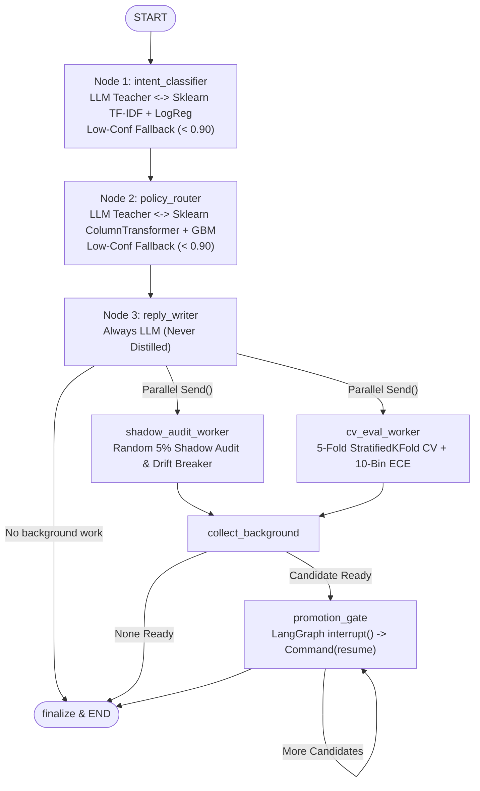

# ZERO-TAX: The Self-Evaporating LangGraph Agent

> **Online LLM-to-`scikit-learn` node distillation for LangGraph workflows** — starts with zero training data using an LLM Teacher, evaluates local `scikit-learn` students in the background with 5-fold cross-validation and Expected Calibration Error (ECE), gates promotion behind a real LangGraph Human-in-the-Loop `interrupt()`, monitors post-promotion accuracy with parallel `Send()` shadow audits, and trips an automatic concept-drift circuit-breaker backed by `SqliteSaver` time-travel.

---

## Architecture



---

## Key LangGraph & ML Features

1. **Selective Node-Level Distillation**: Nodes 1 (`intent_classifier`) and 2 (`policy_router`) distill automatically into fast local `scikit-learn` pipelines (`< 2 ms`, ₹0.00), while Node 3 (`reply_writer`) stays on the LLM Teacher for natural customer replies.
2. **Online Learning with Zero Hand-Written Training Data**: Teacher predictions and metadata flow automatically into `LangGraph Store` (`InMemoryStore`) and feed `NodeDistiller` traces online.
3. **5-Fold CV + 10-Bin ECE Calibration Gate (`Send()`)**: Background `Send()` workers validate `cv_accuracy >= 95%`, `ECE <= 0.10`, and full core class representation before fitting the student model.
4. **Human-in-the-Loop `interrupt()` Promotion Gate**: Pauses execution with full accuracy, calibration, and projected cost/latency savings metrics, resuming only on `Command(resume={"approved": True/False})`.
5. **Confidence-Threshold Fallback**: On promoted nodes, uncertain or out-of-distribution inputs (`max(predict_proba) < 0.90`) automatically route back to the LLM Teacher via `LOW_CONF_FALLBACK` and feed new labeled traces back into the student pool.
6. **Concept-Drift Circuit-Breaker**: Promoted nodes run background `Send()` shadow audits (default 5%). When a new wave hits (e.g., `EMPTY_BOX_SCAM`), rolling agreement below 90% auto-demotes the node to `LLM_TEACHER`, collects fresh traces, retrains across all classes, and re-promotes.
7. **Windows-Safe `SqliteSaver` Checkpointer & Time-Travel**: Custom stdlib `sqlite3` WAL-mode checkpointer supporting `list_checkpoints()`, in-place `rewind`, and isolated branch `fork` operations.

---

## Verified Benchmark Results (Seed `42`, `N = 200` Normal + `50` Drift Tickets)

Measured end-to-end by running [`benchmark.py`](benchmark.py) (`--seed 42 --normal-count 200 --drift-count 50 --teacher-mode simulated`):

| Metric | Naive All-LLM Baseline | ZERO-TAX LangGraph Engine | Delta |
|---|---:|---:|---:|
| **Full-Graph Cost (INR)** | Rs. 98.2969 (`$1.1633`) | Rs. 55.9409 (`$0.6620`) | **43.09% saved** |
| **Distillable Nodes Cost (Nodes 1 & 2, INR)** | Rs. 59.6456 | Rs. 17.2895 | **71.01% saved** |
| **Average Latency / Ticket** | 1839.7 ms | 995.0 ms | **45.91% faster** |
| **Intent Accuracy** | — | **100.0%** | Verified |
| **Policy Accuracy** | — | **100.0%** | Verified |
| **Student Evaporation Rate** | 0.0% | **71.0%** | Nodes 1 & 2 distilled |
| **Low-Confidence Fallback Rate** | — | **4.00%** | Safe Teacher escalation |
| **Drift Auto-Demotion & Recovery** | — | Detected at `#201`, Re-Promoted at `#211` | **100.0% post-recovery accuracy** |

---

## Project Structure

- `core/models.py` — Pydantic v2 schemas (`SupportTicket`, `NodePrediction`, `BenchmarkReport`, `CheckpointSummary`)
- `core/dataset.py` — Seeded synthetic Indian e-commerce dataset generator (normal stream, holdout split, and `EMPTY_BOX_SCAM` drift wave)
- `core/teacher.py` — `LLMTeacher` supporting offline simulated Teacher (`SIMULATED` / `AUTO`) and live `GEMINI` / `OPENAI` backends
- `core/distiller.py` — Online `scikit-learn` pipelines (`TfidfVectorizer` + `LogisticRegression`, `ColumnTransformer` + `GradientBoostingClassifier`), 5-fold CV, 10-bin ECE, and drift circuit-breaker
- `core/checkpointer.py` — WAL-mode `sqlite3` LangGraph `BaseCheckpointSaver` with checkpoint fork and rewind
- `core/graph.py` — `ZeroTaxEngine` (`StateGraph`, `Store`, `Send()`, `interrupt()`, `Command`, time-travel)
- `api.py` — FastAPI backend (`/health`, `/run`, `/stream-batch`, `/approve-promotion`, `/inject-drift`, `/metrics`, `/checkpoints/{thread_id}`, `/rewind`, `/graph-mermaid`)
- `app.py` — Interactive Streamlit live replay, HITL approval, drift simulation, and time-travel dashboard
- `benchmark.py` — Reproducible CLI benchmark outputting JSON & Markdown reports
- `tests/` — Unit and E2E test suite

---

## Quickstart

```bash
# 1. Install dependencies (inside your Python 3.11+ environment)
pip install -r requirements.txt

# 2. Run the full test suite
pytest -v

# 3. Run the reproducible 250-ticket benchmark
python benchmark.py --seed 42 --normal-count 200 --drift-count 50 --output-json reports/benchmark_report.json --output-md reports/benchmark_report.md --teacher-mode simulated

# 4. Launch the interactive Streamlit dashboard
streamlit run app.py

# 5. Or start the FastAPI server
uvicorn api:app --reload --port 8000
```

Optional live cloud Teacher:
```bash
# Windows PowerShell
$env:GEMINI_API_KEY="your-key-here"
```
When no API key is set, `TeacherMode.AUTO` falls back cleanly to the deterministic offline Teacher for reproducible local runs and testing.

---

## One-Sentence Summary (Application Form Ready)

> To cut the cost and latency of running frontier LLMs on repetitive agent decisions, I built ZERO-TAX from scratch using Python, LangGraph (`StateGraph`, `Store`, `Send()`, `interrupt()`, `SqliteSaver`), FastAPI, Streamlit, and `scikit-learn`, where local classifiers train online from LLM Teacher traces, promote behind human-in-the-loop CV/ECE gates, and self-demote on concept drift—delivering 71.01% cost savings on distillable nodes (43.09% full-graph), 45.91% lower latency, and 100.0% intent, policy, and post-recovery accuracy across a 250-ticket benchmark.
